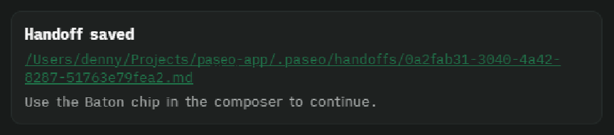
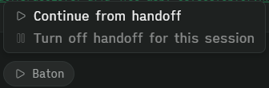

# Baton

A [Paseo](https://paseo.sh) plugin that saves your agent's work state when you walk away.

When an agent finishes a turn and then sits idle, Baton has a short-lived writer agent draft a
handoff document. You can later continue the task in a fresh agent, or hand it to a different
model, without re-reading the whole conversation.



The Baton chip in the composer:


Its menu once a handoff exists, with turning handoffs off disabled:



## Features

- **Automatic handoffs.** After an agent has been idle for a set time, Baton writes
  `<agentId>.md` to `.paseo/handoffs` in the agent's workspace (or your custom location) (Task, Context, Relevant files, Current
  state, What was tried, Decisions, Acceptance criteria, Constraints).
- **Writer subagent.** A `[Handoff writer]` subagent of the idle agent drafts the document and is
  archived after its turn. It shows under that agent's subagents while it runs and Paseo does not send a
  "finished" notification for it, and the idle agent's chat only gains a "Handoff saved" row. If the writer fails, Baton
  falls back to a mechanical summary of the conversation, with no model call.
- **Review in the app.** Clicking the saved path opens the handoff rendered as markdown, with a
  button to open the file in your default app.
- **Baton chip.** Every agent gets a **Baton** chip in the composer with a menu:
  - **Continue from handoff** starts a new agent titled `[Handoff] <task>` in the same workspace
    and opens it.
  - **Create handoff now** writes the handoff immediately instead of waiting for the idle timer. It is
    available only for an idle session with no handoff yet and with handoffs turned on.
  - **Turn off / Turn on handoff for this session** pauses Baton for one agent. It is saved across
    restarts and disabled once a handoff exists. In an ignored workspace or project the menu says so.
- **Stale handoff cleanup.** If you keep working in the original session and nobody continued the
  handoff, Baton deletes the stale file by default. Continued handoffs are kept, and a setting turns
  deletion off.
- **Automatic cleanup.** Once a day, and when Baton starts, it deletes handoff files that nobody
  continued after three days. Handoffs you continued are kept. A setting turns this off or changes
  the number of days. On the first start after updating, handoffs already older than that are deleted.
- **Subagent wait.** If an agent's subagents are still working when the idle timer ends, Baton
  restarts the countdown instead of writing the handoff. A setting turns this off. The countdown
  starts when the agent's own turn ends, since Paseo marks a parent idle regardless of its
  subagents. Only subagents started as Paseo agents are waited for; provider-internal ones (such
  as Claude's Task tool) are invisible to Baton. A subagent still running after four hours, or one that was running when
  the plugin restarted, is not waited for.
- **New projects.** Projects are active by default. A setting under "Ignored projects and
  workspaces" ignores projects that appear later until you switch them on; projects that already
  exist keep their current setting.

## Install

Requires Paseo 0.13.0 or newer. No accounts, tokens, or external tools.

```sh
# from a local checkout
paseo plugin install /path/to/paseo-baton

# or straight from GitHub
paseo plugin add git:dennyferra/paseo-baton
```

Check it with `paseo plugin ls`, and read its logs with `paseo plugin logs baton`. After editing the
code, apply changes with `paseo plugin reload baton`.

## Settings

Under Settings -> Plugins -> Baton:

| Setting | Default | What it does |
| --- | --- | --- |
| Idle delay | 15 min (1-240) | How long an agent sits idle before a handoff is written. Independent of any provider's prompt cache. |
| Agent profile | Same as running agent | Which of your Paseo agent profiles writes the handoff. Its provider, model and effort are used; its mode is ignored. |
| Conversation detail | Standard | How much of the conversation the writer sees: Compact (about 30k characters), Standard (60k) or Full (150k). Long messages keep their start and end, and the writer is told when earlier history was left out. |
| Include repo state | On | Adds the branch, changed files and recent commit titles from git to what the writer sees. Off keeps file names and commit messages out of the draft. |
| Save the writer's prompt | Off | For debugging: keeps the latest prompt sent to the writer for each agent in `~/.paseo/plugin-data/baton/writer-prompts`. It contains conversation text. |
| Storage location | `.paseo/handoffs` in each workspace | Where handoff files are saved. Accepts an absolute path, `~/...`, or a path relative to the workspace. If it can't be used, Baton saves to the default folder and the chat row says why. |
| Delete unused handoffs | On | Deletes a handoff nobody continued once you keep working in the original session. Off keeps every file on disk. |
| Ignored projects and workspaces | none | Agents in an ignored project or workspace never produce handoffs. Ignoring a project covers workspaces created later. |

## Keep handoffs out of version control

Handoff files contain excerpts of your conversations: your messages, the agent's replies, file paths
and tool calls. The default location, `.paseo/handoffs` inside each workspace, is usually inside a git
repository, so add it to that repository's `.gitignore`:

```gitignore
.paseo/handoffs/
```

Or set a storage location outside your repositories in the plugin settings, such as `~/handoffs`.

## How it works

Baton listens to agent lifecycle events. When a turn ends it starts an idle timer, and a new turn
cancels it. When the timer fires on an idle agent, Baton asks the writer agent for the document,
saves it to the workspace, and appends the "Handoff saved" row. Subagents, the writer itself and
ignored workspaces are skipped.

State lives in `~/.paseo/plugin-data/baton/baton-state.json`, so a daemon restart recovers pending
handoffs and re-appends rows for saved ones. Entries are pruned when the agent is archived or after
7 days. Baton only reads lifecycle events and writes handoff files and its own state file. It never
reads credentials and never logs secrets.

See [OVERVIEW.md](OVERVIEW.md) for the plugin overview shipped with the package.

## Development

```sh
npm install
npm run typecheck
npm test
```

Layout:

- `server/` - controller, state store, handoff prompt and timeline summary (daemon side)
- `client/` - Baton chip, chat row, handoff viewer and settings screen (app side)
- `shared/` - Zod contracts, RPCs and settings shared by both sides; no runtime code from either side
- `docs/` - maintainer notes, such as the registry submission text (not shipped in the package)
- `test/` - Vitest tests for the controller, core state machine, store and summaries

Server code must not import client code, and the reverse.

## Limitations

- Paseo gives plugins no way to open a file in the host's own file tab, so Baton renders the
  handoff itself. It supports headings, lists, quotes, code blocks, tables and basic inline styles.
- Chat rows can't be removed, so the "Handoff saved" row stays after a handoff is cleaned up and its
  link then reports the handoff can no longer be opened.
- The Baton chip's state refreshes when an agent's status changes, so a menu left open can be stale
  after you change settings.

## License

Copyright 2026 Denny Ferrassoli. Licensed under the [Apache License 2.0](LICENSE).
