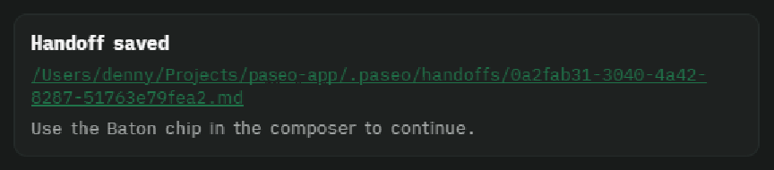
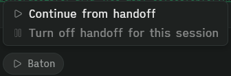

# Baton

A [Paseo](https://paseo.sh) plugin that saves your agent's work state when you walk away.

When an agent finishes a turn and then sits idle, Baton has a short-lived writer agent draft a
handoff document. You can later continue the task in a fresh agent, or hand it to a different
model, without re-reading the whole conversation.



The Baton chip in the composer:


Its menu once a handoff exists, with turning handoffs off disabled:



## Features

- **Automatic handoffs.** After an agent has been idle for a set time, Baton writes
  `<agentId>.md` to `.paseo/handoffs` in the agent's workspace (or your custom location) (Task, Context, Relevant files, Current
  state, What was tried, Decisions, Acceptance criteria, Constraints).
- **Writer subagent.** A `[Handoff writer]` subagent of the idle agent drafts the document. It shows under that
  agent's subagents and Paseo does not send a "finished" notification for it. Baton leaves it there after it
  finishes, so you can open it to read exactly what it was given. Only the latest writer for an agent is kept:
  starting its next handoff archives the earlier one, and Paseo archives the rest with the idle agent.
  The idle agent's own chat only gains a "Handoff saved" row. If the writer fails or saves nothing usable,
  Baton falls back to a mechanical summary of the conversation, with no model call.
- **What the writer sees.** The first request (heartbeat and agent messages count too), your messages and the agent's replies, the files it
  touched, its recent tool calls that name a file or URL, its latest task list and plan, errors and failed
  shell programs (never command lines), sub-agent work, the repo state from `git`, and, when the session was
  started with **Continue from handoff**, the handoff it came from. How much of that depends on the
  Conversation detail setting, and the handoff says when earlier history was left out.
- **Timestamps.** Each handoff file starts with a `Created:` line, and the "Handoff saved" row shows when it was
  saved.
- **Review in the app.** Clicking the saved path opens the handoff rendered as markdown, with a
  button to open the file in your default app.
  - **Baton chip.** Every agent gets a **Baton** chip in the composer with a menu:
    - **Continue from handoff** starts a new agent titled `[Handoff] <task>` in the same workspace
      and opens it. Its first message carries the full handoff text. The "Handoff saved" row in the chat has the same
      link for a handoff nobody has continued. A finished handoff also stays when Paseo closes the agent's idle runtime,
      so Continue still works.
    - **Create handoff now** writes the handoff immediately instead of waiting for the idle timer. It is
      available only for an idle session with no handoff yet and with handoffs turned on.
    - **Turn off / Turn on handoff for this session** pauses Baton for one agent. It is saved across
      restarts and disabled once a handoff exists. In an ignored workspace or project the menu says so.
    - **Set context threshold** lets you set a per-agent threshold percentage for this agent only, or
      clear it back to the global threshold with "Use global threshold".
  - **Context threshold.** At the end of each turn Baton reads the agent's reported context usage. When
    it reaches the effective threshold (60% by default, 10–95%, per-agent override wins), the chip shows
    "Baton 62%" with the last reported percentage and the "Handoff saved" row offers **Create handoff**
    (writes only) and **Create and continue** (writes and opens a new agent). Nothing is written or opened
    until you click. The prompt fires once per context; it re-arms on a new session or a continue.
    Agents that report no context maximum use a 120,000-token fallback: the global percentage applies to it
    (60% is 72,000 tokens), and a per-agent percentage override is ignored there. The idle handoff is kept, and skipped when a handoff
    already exists for the same context.
- **Stale handoff cleanup.** If you keep working in the original session and nobody continued the
  handoff, Baton deletes the stale file by default. Continued handoffs are kept, and a setting turns
  deletion off.
- **Automatic cleanup.** Once a day, and when Baton starts, it deletes handoff files that nobody
  continued after three days. Handoffs you continued are kept. A setting turns this off or changes
  the number of days. On the first start after updating, handoffs already older than that are deleted.
- **Agent read tools (off by default).** Turn on "Let agents read handoffs" to give new interactive
  agents two read-only tools: `baton_list_handoffs` lists the handoffs in their workspace, and
  `baton_read_handoff` reads one by file name. Agents started before you turn it on don't get them.
  Writers never do.
- **Subagent wait.** If an agent's subagents are still working when the idle timer ends, Baton
  restarts the countdown instead of writing the handoff. A setting turns this off. The countdown
  starts when the agent's own turn ends, since Paseo marks a parent idle regardless of its
  subagents. Only subagents started as Paseo agents are waited for; provider-internal ones (such
  as Claude's Task tool) are invisible to Baton. A subagent still running after four hours, or one that was running when
  the plugin restarted, is not waited for.
- **New projects.** Projects are active by default. A setting under "Ignored projects and
  workspaces" ignores projects that appear later until you switch them on; projects that already
  exist keep their current setting.

## Install

Requires Paseo 0.15.0 or newer. No accounts, tokens, or external tools.

```sh
# from a local checkout
paseo plugin install /path/to/paseo-baton

# or straight from GitHub
paseo plugin add git:dennyferra/paseo-baton
```

Check it with `paseo plugin ls`, and read its logs with `paseo plugin logs baton`. After editing the
code, apply changes with `paseo plugin reload baton`.

## Settings

Under Settings -> Plugins -> Baton:

| Setting | Default | What it does |
| --- | --- | --- |
| Idle delay | 15 min (1-240) | How long an agent sits idle before a handoff is written. |
| Wait for subagents | On | If agents the idle agent started are still working when the countdown ends, restart it instead of writing the handoff. |
| Agent profile | Same as running agent | Which of your Paseo agent profiles writes the handoff. Its provider, model and effort are used; its mode is ignored. |
| Conversation detail | Standard | How much of the conversation the writer sees: Compact (about 30k characters), Standard (60k) or Full (150k). Long messages keep their start and end, and the writer is told when earlier history was left out. |
| Include repo state | On | Adds the branch, changed files and recent commit titles from git to what the writer sees. Off keeps file names and commit messages out of the draft. |
| Storage location | `.paseo/handoffs` in each workspace | Where handoff files are saved. Accepts an absolute path, `~/...`, or a path relative to the workspace. If it can't be used, Baton saves to the default folder and the chat row says why. |
| Delete unused handoffs | On | Deletes a handoff nobody continued once you keep working in the original session. Off keeps every file on disk. |
| Clean up old handoffs | On, after 3 days (1-365) | Once a day and at start, deletes handoff files nobody continued that are older than the limit. |
  | Ignored projects and workspaces | none | Agents in an ignored project or workspace never produce handoffs. Ignoring a project covers workspaces created later. |
  | Ignore new projects by default | Off | Projects that appear later start ignored until you switch them on. Projects that already exist keep their setting. |
  | Context threshold | 60% (10-95) | When an agent's reported context usage reaches this percentage of its context window, Baton offers a handoff. Change it per agent from the Baton menu. |
  | Context fallback | 120,000 tokens | When an agent reports no context maximum, the global threshold percentage applies to this limit (60% is 72,000 tokens). A per-agent percentage override is ignored there. |

Changes are saved automatically a moment after you make them.

## Keep handoffs out of version control

Handoff files contain excerpts of your conversations: your messages, the agent's replies, file paths
and tool calls. The default location, `.paseo/handoffs` inside each workspace, is usually inside a git
repository, so add it to that repository's `.gitignore`:

```gitignore
.paseo/handoffs/
```

Or set a storage location outside your repositories in the plugin settings, such as `~/handoffs`.

## How it works

Baton listens to agent lifecycle events. When a turn ends it starts an idle timer, and a new turn
cancels it. When the timer fires on an idle agent, Baton reads its conversation back from Paseo, starts a
writer subagent with a draft built from it, and takes the document the writer returns (or the file it
saved itself), stamps it with a `Created:` line, saves it to the workspace and appends the "Handoff saved"
row. Subagents, writers and ignored workspaces are skipped. At the end of each turn Baton also reads the
agent's reported context usage (`lastUsage`, including `contextWindowUsedTokens` and
`contextWindowMaxTokens`, where some providers leave the maximum unset) through `refresh()`; when the use
reaches the effective threshold it offers the handoff prompt without writing anything. The threshold is a
whole percentage (10–95%, default 60%) that can be overridden per agent from the Baton menu. It fires once
per context and re-arms on a new session or a continue. Agents that report no context maximum use a
120,000-token fallback as an absolute limit, with no per-agent percentage. The idle handoff is kept, and
skipped when a context handoff already exists for the same context.

State lives in `~/.paseo/plugin-data/baton/baton-state.json` and `~/.paseo/plugin-data/baton/baton-context-state.json`,
so a daemon restart recovers pending handoffs, re-appends rows for saved ones, and keeps per-agent
threshold overrides and last reported percentages. Entries are pruned when the agent is archived or after
7 days; the chat rows still open and continue those handoffs. Baton reads agent lifecycle events and the conversation through Paseo, runs read-only `git` commands in
the workspace, and writes handoff files and its own state file. It never reads credentials and never logs secrets.

See [OVERVIEW.md](OVERVIEW.md) for the plugin overview shipped with the package.

## Development

```sh
npm install
npm run typecheck
npm test
```

Layout:

- `server/` - controller, state store, handoff prompt, timeline summary, repo state and the agent read tools (daemon side)
- `client/` - Baton chip, chat row, handoff viewer and settings screen (app side)
- `shared/` - Zod contracts, RPCs and settings shared by both sides; no runtime code from either side
- `docs/` - maintainer notes, such as the registry submission text (not shipped in the package)
- `test/` - Vitest tests for the controller, core state machine, store, summaries, agent read tools, settings and context-usage state; `test/support/` holds shared test helpers

Server code must not import client code, and the reverse.

## Limitations

- Paseo gives plugins no way to open a file in the host's own file tab, so Baton shows the handoff in
  its own screen, rendered with Paseo's Markdown component.
- Chat rows can't be removed, so the "Handoff saved" row stays after a handoff is cleaned up and its
  link then reports the file missing.
- The Baton chip's state refreshes when an agent's status changes, so a menu left open can be stale
  after you change settings.
- If Paseo restarts while a handoff is being written, that handoff can be cut off. With "Resume agents
  after restart" on, Paseo may also resume agents that were running at the restart. In our one test
  the interrupted writer was closed and not resumed, and no handoff was confirmed. Turn that Paseo
  setting off while you rely on Baton, or check for a missing handoff after a restart.

## License

Copyright 2026 Denny Ferrassoli. Licensed under the [Apache License 2.0](LICENSE).
